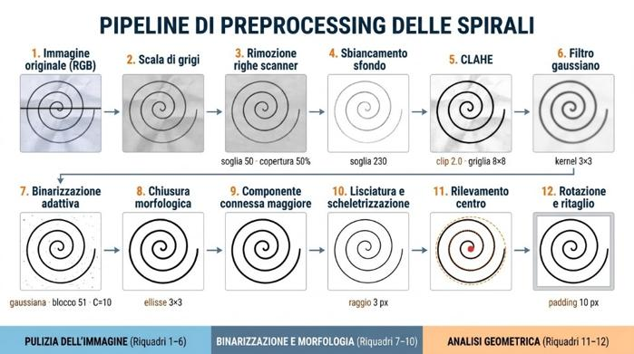
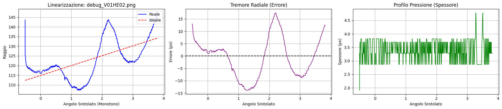
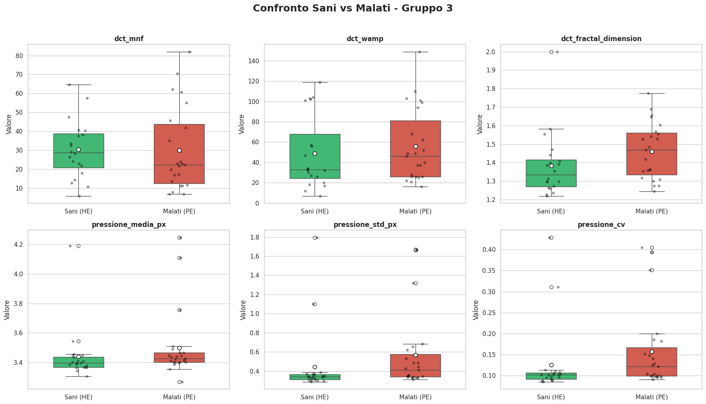

# Analisi quantitativa del tremore patologico da spirali di Archimede

Pipeline automatica che, a partire dalla scansione di una spirale di Archimede disegnata a mano, estrae 21 descrittori quantitativi del tratto e confronta soggetti sani e pazienti con tremore.

[](https://colab.research.google.com/github/LucaFiorini21/spiral-tremor-analysis/blob/main/notebooks/SpiraliFINALE.ipynb)

**Autori:** Giuseppe Conti, Luca Fiorini, Elena Fratoni
**Corso:** Circuiti e Algoritmi per il Trattamento di Segnali Multimediali e Biosegnali, Ingegneria Medica, Università di Roma Tor Vergata (A.A. 2025/2026)

📄 [Relazione](docs/Relazione.pdf) · 📊 [Presentazione](docs/Presentazione.pdf)

## Obiettivo

La valutazione clinica del tremore con il test della spirale è in larga parte visiva e soggettiva. Il progetto sostituisce l'osservazione con misure oggettive e riproducibili dell'ampiezza, della regolarità e della complessità del tratto, e individua quali descrittori distinguono meglio il gruppo di controllo (**HE**, sani) dal gruppo dei pazienti (**PE**).

Le scansioni sono immagini statiche, senza informazione temporale: le misure sono in pixel e le frequenze in cicli per campione lungo la spirale (non in Hz). Lo "spessore" del tratto è usato come indicatore indiretto della pressione, non come misura fisica.

## Metodo



1. **Preprocessing** (`src/preprocessing.py`): scala di grigi, rimozione delle righe dello scanner, sbiancamento dello sfondo, CLAHE, filtro gaussiano, soglia adattiva, chiusura morfologica, selezione della componente connessa principale, scheletrizzazione (Zhang–Suen) e ridilatazione a spessore uniforme.
2. **Centro della spirale**: estremità libere dello scheletro, baricentro dell'inchiostro e cerchio ai minimi quadrati sul nucleo interno.
3. **Linearizzazione** (`src/features.py`): il tracciato viene ordinato, portato in coordinate polari, srotolato (`np.unwrap`), filtrato per monotonicità e confrontato con la spirale di Archimede ideale `r = mθ + c` stimata ai minimi quadrati. La differenza è il **segnale di errore radiale**, filtrato con una mediana a 3 campioni.
4. **Feature** (21, in cinque domini):

| Dominio | Feature |
|---|---|
| Ampiezza e lunghezza | `error_distance_mean`, `mean_absolute_value_mav`, `tremore_rms`, `tremore_std`, `lunghezza_spirale_reale` |
| Spettro (Welch) | `frequenza_dominante_rad`, `mean_frequency_mnf_rad`, `psd_tremor_band_energy_rad` |
| Forma e complessità | `kurtosis`, `skewness` (Bowley), `fractal_dimension_katz`, `approximate_entropy` |
| DCT | `dct_mnf`, `dct_wamp`, `dct_fractal_dimension` |
| Spessore del tratto | `pressione_media_px`, `pressione_std_px`, `pressione_cv`, `pressione_range_px`, `pressione_fractal_dimension_katz`, `pressione_num_variazioni_significative` |

5. **Statistica** (`src/analysis.py`): boxplot Sani vs Malati e test di Mann-Whitney bilaterale per ogni feature.


*Da sinistra: raggio reale e spirale ideale, segnale di errore radiale, profilo di spessore.*

## Risultati principali

Su 102 scansioni, cinque feature differiscono in modo significativo tra i due gruppi (Mann-Whitney, p < 0.05):

| Feature | Mediana Sani (HE) | Mediana Malati (PE) | p-value |
|---|---:|---:|---:|
| `skewness` (Bowley) | −0.043 | 0.204 | 0.021 |
| `pressione_std_px` | 0.341 | 0.411 | 0.031 |
| `pressione_cv` | 0.102 | 0.122 | 0.035 |
| `pressione_range_px` | 1.91 | 2.87 | 0.039 |
| `dct_fractal_dimension` | 1.334 | 1.469 | 0.040 |

Le misure di ampiezza (RMS, errore medio) e le feature spettrali non separano i gruppi. Contano di più l'asimmetria dell'errore, la variabilità dello spessore e la complessità nel dominio DCT.



Gli altri boxplot sono in [`figures/`](figures/).

## Come eseguire il codice

### Con Python in locale

```bash
git clone https://github.com/LucaFiorini21/spiral-tremor-analysis.git
cd spiral-tremor-analysis
python -m venv .venv
source .venv/bin/activate        # Windows: .venv\Scripts\activate
pip install -r requirements.txt

python src/run_pipeline.py --input data/raw --output results --plots 5
```

Le scansioni vanno messe in `data/raw/` con nomi del tipo `V01HE01.png` / `V07PE02.png` (vedi [`data/README.md`](data/README.md)). In `results/` vengono salvati:

- `preprocessed/`: immagini preprocessate con il centro trovato segnato;
- `features.csv`: le 21 feature per immagine;
- `mann_whitney.csv`: mediane per gruppo e p-value;
- `boxplot/`: grafici Sani vs Malati;
- `linearizzazione/`: grafici di linearizzazione delle prime N immagini (`--plots N`).

### Con il notebook

`notebooks/SpiraliFINALE.ipynb` è il notebook originale, pensato per Google Colab con le immagini su Google Drive. Prima di eseguirlo, aggiornare i percorsi nella cella di configurazione (`INPUT_DIR`, `OUTPUT_DIR`). Il codice in `src/` produce le stesse immagini e le stesse feature del notebook.

## Struttura

```
spiral-tremor-analysis/
├── README.md
├── src/
│   ├── preprocessing.py   # pulizia, binarizzazione, morfologia, centro della spirale
│   ├── features.py        # linearizzazione ed estrazione delle 21 feature
│   ├── analysis.py        # boxplot e test di Mann-Whitney
│   └── run_pipeline.py    # esegue tutta la pipeline da riga di comando
├── notebooks/
│   └── SpiraliFINALE.ipynb
├── docs/
│   ├── Relazione.pdf
│   └── Presentazione.pdf
├── figures/               # figure usate in questo README
├── data/                  # le immagini non sono incluse (vedi data/README.md)
├── requirements.txt
├── .gitignore
└── LICENSE
```

## Riferimenti

- Dataset **HandPD**: C. R. Pereira et al., *A new computer vision-based approach to aid the diagnosis of Parkinson's disease*, Computer Methods and Programs in Biomedicine, 2016.
- Le feature sono scelte sulla base della letteratura citata nella relazione: Solé-Casals et al. (2019), Aghanavesi et al. (2017), Yoon et al. (2023), Khan et al. (2024), Wang et al. (2025), Carfora et al. (2022), Li et al. (2022), López-de-Ipiña et al.

## Licenza

Codice rilasciato con licenza [MIT](LICENSE). Relazione e presentazione restano degli autori.
